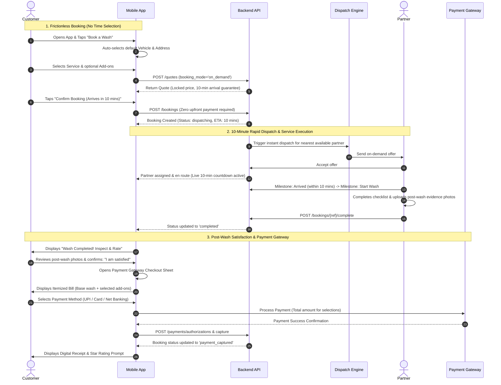

# Smooth Wash Booking, 10-Minute Dispatch & Post-Wash Payment Gateway Implementation Plan

This implementation plan details the architecture, UX flows, data contracts, state transitions, payment gateway integration, and testing strategy for a frictionless on-demand car wash booking experience.

---

## 1. Executive Summary & Core Requirements

| Requirement | Current State | Target State |
| :--- | :--- | :--- |
| **Booking Friction** | Multi-step quote with required slot scheduling | **Ultra-smooth booking flow**: smart defaults (pre-selected default car & address), single-tap add-on toggling, instant dynamic pricing. |
| **Time Selection** | Requires user to browse and pick a time slot | **Zero time selection**: Scheduled slots removed. All bookings are strictly **on-demand** (`booking_mode: 'on_demand'`). |
| **Partner Arrival SLA** | Vague window or scheduled hour | **Guaranteed 10-minute arrival promise**: Immediate automated dispatch. Real-time 10-minute countdown timer and live partner tracking. |
| **Payment Timing** | Upfront authorization required at booking confirmation | **Zero upfront charging**: Customer commits to booking with \$0 charged upfront. Payment gateway only activates **after the wash is completed AND customer confirms satisfaction**. |
| **Payment Gateway** | Basic mock pre-authorization card stub | **Full post-wash Payment Gateway**: Itemized invoice matching exact wash selections (base tier + add-ons), supporting UPI, Cards, Net Banking, Apple/Google Pay, with idempotent capture. |
| **Testing Coverage** | No automated mobile test suites configured | **Complete test suite**: Jest + React Native Testing Library covering booking without time slots, 10-min countdown, satisfaction gate, payment gateway, and end-to-end flow. |

---

## 2. End-to-End System Architecture & User Journey



---

## 3. Detailed Component & Feature Design

### Phase 1: Smooth Booking Experience (Zero Time Selection)

#### 1.1 Quote Builder (`app/booking/quote.tsx`)
- **Remove Time Slot Selection**:
  - Remove Section 5 "Choose a time", slot picker card, and slot availability query dependencies.
  - Automatically enforce `booking_mode: 'on_demand'` in quote creation.
- **Smart Ergonomic Pre-selections**:
  - If user has a default vehicle (`is_default: true`), auto-select it.
  - If user has a default address (`is_default: true`), auto-select it.
  - User can proceed with just 2 taps: choose service -> tap "Get Instant Price".
- **Dynamic Price Bar**:
  - Floating bottom bar showing current selected service + add-ons count with estimated total before creating quote.
- **Arrival SLA Callout**:
  - Prominent badge: *"⚡ On-Demand Service: Partner reaches your car within 10 minutes"*.

#### 1.2 Quote Review & Instant Confirmation (`app/booking/quote-review.tsx` & `confirm.tsx`)
- **Review Screen**:
  - Prominently displays:
    1. Vehicle & Address details.
    2. Selected Wash Package + all chosen Add-ons with individual pricing.
    3. Clear declaration: *"No upfront payment. You will only be charged after the wash is completed to your satisfaction."*
    4. Button: *"Book Wash (Partner arriving in 10 mins)"*.
- **Confirmation Screen**:
  - Remove the upfront card pre-authorization step (`step: 'authorise'`).
  - Booking is created directly: `bookingApi.create(quoteId)` with `no_contact` preference.
  - Immediately navigates to `/booking/${booking.reference}` without payment gateway friction.

---

### Phase 2: 10-Minute SLA Dispatch & Real-Time Tracking

#### 2.1 Countdown & SLA Component (`src/components/booking/ArrivalCountdown.tsx`)
- Computes arrival deadline: `created_at + 10 minutes`.
- Renders an animated circular or pill timer showing:
  - Remaining time: `MM:SS` (e.g. `08:45`).
  - Status messages:
    - *Searching for nearest partner...* (0-2 min)
    - *Partner assigned & driving to you* (2-8 min)
    - *Partner arriving now!* (8-10 min)
  - Haptic feedback when partner arrives.

#### 2.2 Tracking Screen Enhancement (`app/booking/[reference]/index.tsx`)
- Prominent 10-minute SLA card at the top.
- Real-time milestone tracker (`assigned` -> `en_route` -> `arrived` -> `in_service` -> `completed`).
- Live partner card with masked call/chat buttons and live ETA badge.

---

### Phase 3: Post-Wash Customer Satisfaction Gate

#### 3.1 Satisfaction Verification (`src/components/booking/SatisfactionGate.tsx`)
Triggered automatically when `booking.status === 'completed'` and `payment_state !== 'captured'`:
1. **Inspection Header**: *"Your Car Wash is Finished!"*.
2. **Photo Proof Carousel**: Displays the partner's post-wash evidence photos side-by-side with pre-wash photos.
3. **Satisfaction Check Action**:
   - Primary Action: **"I am Satisfied — Proceed to Payment"** -> Opens Payment Gateway.
   - Secondary Action: **"I'm Not Satisfied / Need Touch-Up"** -> Opens dispute/touch-up modal:
     - Allows customer to select areas needing attention (e.g., rims, interior windows, rear bumper).
     - Allows adding notes or attaching photos.
     - Creates support case (`bookingApi.reportIssue`), holding payment until ops or partner resolves it.

---

### Phase 4: Post-Service Payment Gateway Integration

#### 4.1 Payment Gateway Modal (`src/components/payment/PaymentGatewayModal.tsx`)
An interactive, high-trust checkout experience:

```
+-------------------------------------------------------+
|  Complete Wash Payment                                |
+-------------------------------------------------------+
|  Itemized Selections:                                 |
|  - Exterior Foam & Gloss Wash             $25.00      |
|  - SUV Vehicle Size Tier                   $5.00      |
|  - Add-on: Tyre Dressing & Shine           $4.00      |
|  - Add-on: Interior Deep Vacuum            $8.00      |
|  ---------------------------------------------------  |
|  Subtotal:                                $42.00      |
|  Taxes & Service Fee (5%):                 $2.10      |
|  Total Charged:                           $44.10      |
+-------------------------------------------------------+
|  Select Payment Method:                               |
|  [x] UPI (Google Pay / PhonePe / Paytm / UPI ID)      |
|  [ ] Credit / Debit Card (Visa, Mastercard, RuPay)    |
|  [ ] Net Banking / Digital Wallets                    |
|  [ ] Apple Pay / Google Pay                           |
+-------------------------------------------------------+
|  [ Pay $44.10 Securely ]                              |
|  🔒 256-bit encrypted. Charged only on satisfaction.   |
+-------------------------------------------------------+
```

#### 4.2 Payment Gateway Flow & State Machine
1. **Initiate**: Calculates exact total minor units from the booking's quote lines (base + tier + addons + tax).
2. **Authorize & Capture**:
   - Executes payment via selected gateway adapter (Razorpay / Stripe / Mock Native Gateway).
   - Backend idempotency key ensures no double-charging.
   - API call: `paymentApi.authorize` and `paymentApi.capture` (or a unified `/bookings/{reference}/pay` endpoint).
3. **Success State**:
   - Displays payment success checkmark animation.
   - Updates local query cache to `payment_captured`.
   - Shows receipt download option.
   - Transitions smoothly to the 5-star rating & review card.

---

### Phase 5: Automated Testing Strategy

#### 5.1 Test Configuration
- Create `jest.config.js` configured with `preset: 'jest-expo'`.
- Setup module aliases (`@/*` -> `./src/*` and `./app/*`).
- Add `"test": "jest"` and `"test:watch": "jest --watch"` scripts to `package.json`.

#### 5.2 Test Suites Breakdown

| Test File | Target Feature | Specific Scenarios Tested |
| :--- | :--- | :--- |
| `__tests__/booking/OnDemandBooking.test.tsx` | Quote Builder & On-Demand Booking | - Renders vehicle, address, and service selectors.<br>- **Verifies NO time slot picker is rendered**.<br>- Verifies `booking_mode: 'on_demand'` is passed to `quoteApi.create`.<br>- Verifies add-ons toggle properly and update selection state.<br>- Verifies smooth transition to quote review. |
| `__tests__/booking/ArrivalSlaCountdown.test.tsx` | 10-Minute SLA Arrival Tracker | - Calculates correct 10-minute target timestamp from `created_at`.<br>- Formats remaining countdown accurately (e.g. `09:59`).<br>- Handles timer expiration gracefully.<br>- Displays appropriate status badges during countdown. |
| `__tests__/satisfaction/SatisfactionGate.test.tsx` | Customer Satisfaction Verification | - Renders when `booking.status === 'completed'` and unpaid.<br>- Displays post-wash evidence photos.<br>- Clicking "I am satisfied" triggers payment modal.<br>- Clicking "Not satisfied" opens dispute/report flow and halts payment. |
| `__tests__/payment/PaymentGateway.test.tsx` | Post-Wash Payment Gateway | - Correctly itemizes base wash and selected add-ons.<br>- Calculates exact subtotal, tax, and final amount.<br>- Switches between payment methods (UPI, Card, Wallet).<br>- Executes payment with idempotency key.<br>- Handles payment failure, network error, and retry flow. |
| `__tests__/e2e/WashBookingFlow.test.tsx` | Full End-to-End Function Test | - End-to-end integration: User selects car/address/wash -> Books on-demand -> Partner arrives in 10m -> Wash completed -> Customer inspects & confirms satisfaction -> Payment Gateway charges exact amount -> Receipt & Rating. |

---

## 4. File Modification & Creation Roadmap

### Modified Files:
1. `washing-app/package.json`: Add `"test": "jest --runInBand"` script.
2. `washing-app/app/booking/quote.tsx`: Remove slot picker, configure automatic on-demand mode, add 10-min arrival guarantee callouts.
3. `washing-app/app/booking/quote-review.tsx`: Update review details to highlight on-demand 10-min arrival and zero upfront payment.
4. `washing-app/app/booking/confirm.tsx`: Bypass upfront pre-authorization, book directly on-demand.
5. `washing-app/app/booking/[reference]/index.tsx`: Integrate 10-min SLA countdown timer, satisfaction verification card, and payment gateway trigger.
6. `washing-app/src/api/endpoints.ts`: Add post-wash payment checkout helper if needed.

### New Files:
1. `washing-app/jest.config.js`: Jest testing configuration with `jest-expo` preset and path mappings.
2. `washing-app/src/components/booking/ArrivalCountdown.tsx`: Real-time 10-minute SLA timer component.
3. `washing-app/src/components/booking/SatisfactionGate.tsx`: Customer inspection and satisfaction verification component.
4. `washing-app/src/components/payment/PaymentGatewayModal.tsx`: Complete itemized payment gateway sheet supporting UPI/Card/Wallet.
5. `washing-app/__tests__/booking/OnDemandBooking.test.tsx`: Unit tests for time-less on-demand booking.
6. `washing-app/__tests__/booking/ArrivalSlaCountdown.test.tsx`: Unit tests for 10-minute arrival countdown.
7. `washing-app/__tests__/satisfaction/SatisfactionGate.test.tsx`: Unit tests for customer satisfaction gate.
8. `washing-app/__tests__/payment/PaymentGateway.test.tsx`: Unit tests for post-wash payment gateway and pricing itemization.
9. `washing-app/__tests__/e2e/WashBookingFlow.test.tsx`: Integration test for complete booking -> completion -> satisfaction -> payment flow.

---

## 5. Verification & Exit Criteria

1. **Static Typing & Linting**: `npx tsc --noEmit` passes with 0 errors.
2. **Jest Test Suite**: `npm test` runs all unit and integration test suites with 100% pass rate.
3. **UX Verification**:
   - Booking screen has zero time slot dropdowns or calendars.
   - Quote is created with `booking_mode: 'on_demand'` and clear "Partner arrives in 10 mins" message.
   - Active booking displays live 10-minute arrival countdown.
   - No payment is charged upfront at booking confirmation.
   - Completed wash prompts satisfaction inspection.
   - Confirming satisfaction opens payment gateway with exact breakdown of customer's wash selections.
